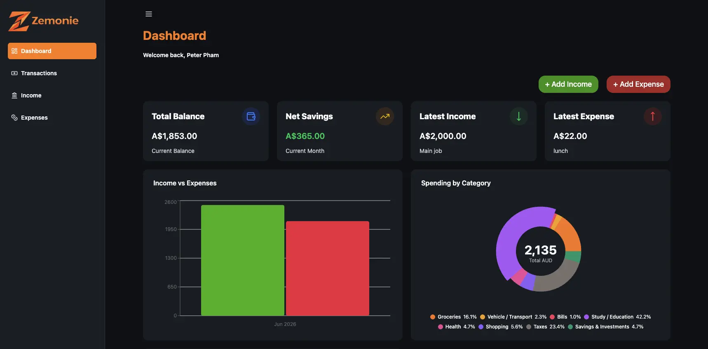

# Zemonie

Money management built for Gen Z — track spending, manage budgets, and grow savings with clarity.

[](https://github.com/Pet3r1512/Zemonie/actions/workflows/ci.yaml)
[](https://app.codecov.io/gh/Pet3r1512/Zemonie)
[](LICENSE)

---

## About the Project

Many members of Gen Z struggle with managing their finances and planning for the future. **Zemonie** is designed to provide greater clarity around spending habits and financial decisions.

In its initial release, Zemonie offers a simple platform where users can easily track expenses, make notes about spending, and visualize income and expenses through intuitive charts.

**Live:** [zemonie.site](https://www.zemonie.site)

---

## Features

### Transactions

- Create income and expense transactions with common categories
- View all transactions grouped by date, with a transaction details popup
- Update transactions
- Recurring transactions — automatically repeat income and expense entries

### Budgets

- Create monthly budgets for a specific expense category (one budget per category)
- Progress bar shows the percentage of budget used
- Recurring budgets automatically carry over to the next month
- Detailed budget view with spending progress and key information
- Edit budgets and related data — recalculates automatically

### Dashboard

- Current balance overview
- Overall analytics for spending behaviour
- Bar chart comparing income and expenses in the current month
- Pie chart displaying spending breakdown by categories
- Last 7 days spending chart
- Net savings for the current month, with savings rate
- Income growth and personalized insights (e.g. highest income of the month, top spending category)

### Currencies & Preferences

- Multi-currency support: AUD, USD, VND with automatic currency formatting
- Account setup wizard with avatar picker and currency selection
- Dark mode with theme settings
- Customisable profile avatar

### Security

- All financial amounts (transactions, budgets, balances) are encrypted at rest with AES-256-GCM
- Email verification
- Password reset via email link
- Password update in user's profile

---

## Tech Stack

| Layer               | Technology                                                                                                     |
| ------------------- | -------------------------------------------------------------------------------------------------------------- |
| **Client**          | React 19, TypeScript, Vite, TanStack Router, TanStack Query, Zustand, Tailwind CSS v4, shadcn/ui, Lucide Icons |
| **Server**          | Hono, tRPC, TypeScript, Prisma, Neon PostgreSQL, Better-Auth, Brevo                                            |
| **Infrastructure**  | Cloudflare Workers (client + server), Wrangler                                                                 |
| **Testing**         | Vitest, React Testing Library, Playwright (Storybook browser tests)                                            |
| **Package Manager** | pnpm (monorepo)                                                                                                |

---

## Screenshots

<!-- Add screenshots here -->
<p align="center">
  
</p>

---

## Getting Started

### Prerequisites

- [Node.js](https://nodejs.org/) 22+
- [pnpm](https://pnpm.io/installation)
- A [Neon PostgreSQL](https://neon.tech/) database (or local Postgres for development)
- A [Brevo](https://www.brevo.com/) account for transactional email
- A Cloudflare account (for deployment)

### Installation

Clone the repository:

```bash
git clone https://github.com/Pet3r1512/Zemonie.git
cd Zemonie
```

Install dependencies:

```bash
pnpm install
```

### Environment Setup

Create the environment files:

```bash
# Client
cp client/.env.example client/.env.local   # if .env.example exists

# Server
cp server/.dev.vars.example server/.dev.vars   # if .dev.vars.example exists
```

Required server variables (`.dev.vars`):

```env
DATABASE_URL="postgresql://..."
BETTER_AUTH_SECRET="your-secret"
BETTER_AUTH_URL="http://localhost:8787"
ENCRYPTION_KEY="your-32-byte-base64-key"
BREVO_API_KEY="your-brevo-api-key"
TRUSTED_ORIGINS="http://localhost:5173"
```

### Running Locally

Start both workspaces in development mode:

```bash
pnpm dev
```

- Client: `http://localhost:5173` (Vite)
- Server: `http://localhost:8787` (Wrangler)

Vite proxies `/api/*` to the local server worker automatically.

### Running Tests

```bash
# Client (jsdom unit & component tests)
pnpm --dir client test

# Client with coverage
pnpm --dir client coverage

# Server tests
pnpm --dir server test

# Server with coverage
pnpm --dir server coverage
```

### Building

```bash
# Client
pnpm --dir client build

# Server (generates Prisma client)
cd server && pnpm prisma generate && pnpm wrangler deploy --minify
```

---

## Project Structure

```
Zemonie/
├── client/                 # React SPA (Vite + TanStack Router + Tailwind v4)
├── server/                 # Hono + tRPC API (Prisma + Neon PostgreSQL)
├── public/                 # Brand assets
├── .github/                # GitHub Actions workflows (CI, E2E, deploy)
├── AGENTS.md               # Development guidelines for contributors & AI agents
├── CONTRIBUTING.md         # Contributing guide
├── SECURITY.md             # Security policy
├── CODEOWNERS              # Repository ownership
├── SYSTEM_DESIGN.md        # High-level architecture & flow diagrams
├── PROJECT_STRUCTURE.md    # Detailed folder/route/API map
└── package.json            # Root workspace scripts
```

---

## Roadmap

- [x] Transactions (create, view, update, recurring)
- [x] Budgets (monthly, recurring, progress tracking)
- [x] Dashboard analytics & charts
- [x] Multi-currency support (AUD, USD, VND)
- [x] Encrypted financial data at rest
- [ ] Multiple money sources (bank accounts, digital wallets...)
- [ ] Group expense sharing for outings
- [ ] Savings goal categories (tuition, family savings, etc.)
- [ ] Dedicated mobile application

---

## Docker (Run with Containers)

Use Docker to run the client and server in a production-like setup without installing Node/pnpm locally. The client is built with Vite and served by Nginx; the server runs with `tsx` via the Node adapter.

### Prerequisites
- [Docker Desktop](https://www.docker.com/products/docker-desktop/) or Docker Engine
- A valid `server/.env` file (gitignored). It must contain the required secrets for the server (database, auth, encryption, Brevo, etc.)

### Quick Start (Recommended)
```bash
# From the root of the repo
docker compose up --build -d
```

This builds and starts both services:
- Server waits for its healthcheck before the client starts
- Client is built with `VITE_SERVER_URL=http://localhost:9999` by default
- Server runs in `NODE_ENV=development` with local CORS/trusted origins

| Service | URL | Notes |
| :-- | :-- | :-- |
| Client (Nginx) | `http://localhost:8080` | Production build, served statically. SPA fallback enabled. |
| Server (Node + tsx) | `http://localhost:9999` | Healthchecked at `/`. API routes under `/api/*`. |

### Environment Variables

#### Server (`server/.env`)
Loaded via `env_file`. Compose overrides some values for local container usage.

| Variable | Purpose | Notes |
| :-- | :-- | :-- |
| `NODE_ENV` | Environment mode | Overridden to `development` by compose. Enables localhost CORS and dev DB selection. |
| `PORT` | Server port | Overridden to `9999` by compose. |
| `BETTER_AUTH_URL` | Auth base URL | Overridden to `http://localhost:9999` by compose. |
| `DEV_DATABASE_URL` / `DATABASE_URL` | Database connection | `prisma.ts` prefers `DEV_DATABASE_URL` when `NODE_ENV=development`. Use `host.docker.internal` if pointing to a local Postgres instance. |
| `BETTER_AUTH_SECRET` | Auth secret | Required. |
| `ENCRYPTION_KEY` | Encryption key | Required to encrypt/decrypt monetary amounts. |
| `BREVO_API` | Brevo API key | Required for transactional emails. |
| `TRUSTED_ORIGINS` | Allowed origins | In dev the server is permissive, but keep it set. |

#### Client
`VITE_SERVER_URL` is baked in at build time via the `VITE_SERVER_URL` build arg. Default is `http://localhost:9999` in Compose. Changing it requires rebuilding the image.

### Manual Build & Run (Without Compose)
```bash
# Build images
docker build -f server/Dockerfile -t zemonie-server .
docker build -f client/Dockerfile --build-arg VITE_SERVER_URL=http://localhost:9999 -t zemonie-client .

# Run server
docker run --rm -p 9999:9999 \
  --env-file server/.env \
  -e NODE_ENV=development \
  -e PORT=9999 \
  -e BETTER_AUTH_URL=http://localhost:9999 \
  zemonie-server

# Run client
docker run --rm -p 8080:8080 zemonie-client
```

### Useful Commands
```bash
# View running containers and health
docker compose ps

# Follow logs
docker compose logs -f server
docker compose logs -f client

# Stop and remove containers
docker compose down

# Rebuild after making changes
docker compose up --build -d

# Check migrations
docker compose exec server pnpm exec prisma migrate status

# Apply migrations
docker compose exec server pnpm exec prisma migrate deploy
```

### Important Notes & Caveats
- **No hot reload**: Client is a production build served by Nginx. Server runs with `tsx` with no watch mode. Changes require rebuilding images.
- **Secrets not committed**: `server/.env`, `.dev.vars`, `.env.*` are gitignored. Contributors must provide their own.
- **Database**: Defaults to the dev Neon database via `DEV_DATABASE_URL`. For a local Postgres instance, use `host.docker.internal` in the connection string.
- **Migrations are not automatic**: Containers do not run `prisma migrate deploy` on startup. Run manually if needed.
- **Cron not supported**: Cloudflare `scheduled()` jobs are not executed by the Node adapter; only run in Workers/Wrangler.
- **CORS/Auth**: Use `localhost` (not `127.0.0.1`) for consistency with cookies. Compose forces `NODE_ENV=development` for local use.
- **Dev dependencies included**: Server image includes devDependencies because `tsx` is used at runtime.
- **Browser calls API directly**: The client does not proxy `/api`; requests go to `VITE_SERVER_URL`. CORS must allow the origin.

## Contributing

Contributions are welcome! Please read [CONTRIBUTING.md](CONTRIBUTING.md) for details on our code of conduct, branching model, commit conventions, and the process for submitting pull requests.

1. Fork the repo
2. Create your feature branch (`git checkout -b feature/amazing-feature`)
3. Commit your changes (`git commit -m 'feat: add amazing feature'`)
4. Push to the branch (`git push origin feature/amazing-feature`)
5. Open a Pull Request

---

## License

Distributed under the MIT License. See [`LICENSE`](LICENSE) for more information.

---

## Contact

Zemonie's Creator — [@Pet3r1512](https://github.com/Pet3r1512)

Project Link: [https://github.com/Pet3r1512/Zemonie](https://github.com/Pet3r1512/Zemonie)

---

<p align="right"><a href="#top">back to top</a></p>
