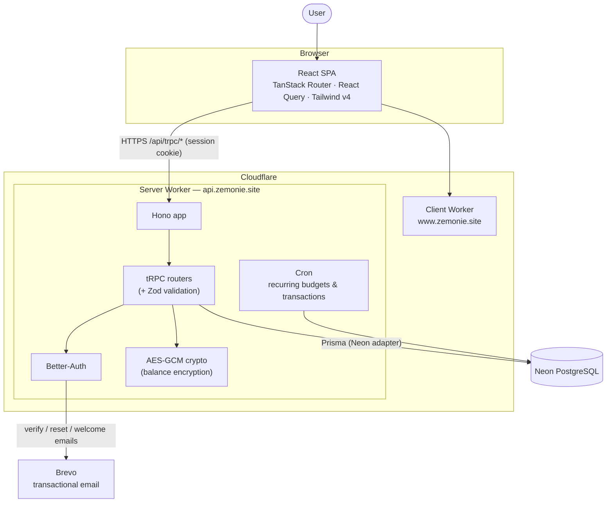
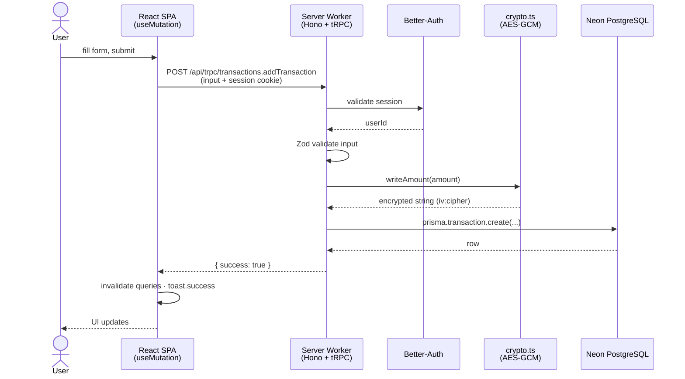
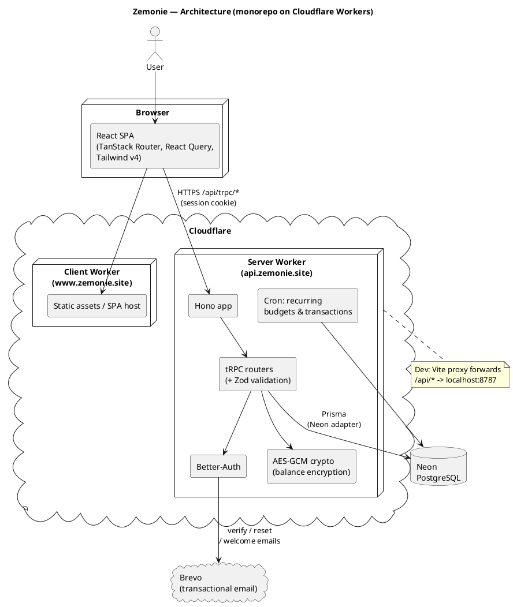
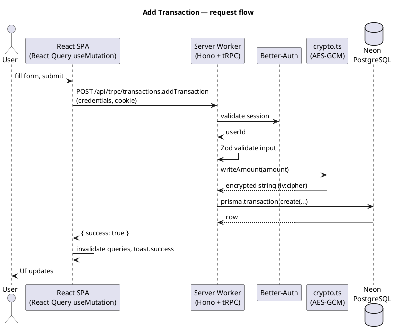

# Zemonie — System Design

Zemonie is a Gen Z–focused money management app. It is a **pnpm monorepo** with two
workspaces, both deployed to **Cloudflare Workers**:

- `client/` — React SPA (Vite + TanStack Router + React Query + Tailwind v4).
- `server/` — Hono + tRPC API (Better-Auth, Zod, Prisma + Neon PostgreSQL).

See `PROJECT_STRUCTURE.md` for the full folder/route/API map and `DESIGN_SYSTEM.md`
for the visual design reference.

---

## High-level architecture

> **Dev vs Prod routing**
>
> - **Dev:** Vite proxy forwards `/api/*` to the local server worker on `localhost:8787`.
> - **Prod:** `www.zemonie.site` → client worker, `api.zemonie.site` → server worker.
>   Auth session cookies are shared across the `zemonie.site` subdomains.
> - A cron job pings the server every ~5 min to keep the database warm.

---

## Request flow — "Add transaction"

This path exercises the auth guard, Zod validation, and AES-GCM amount
encryption before the row is persisted.

---

## Data at rest — amount encryption

Monetary `amount` fields (balances, transactions) are stored **encrypted** with
AES-256-GCM (`server/src/lib/crypto.ts`):

- A random 12-byte IV is generated per write and prepended to the ciphertext
  (`iv:cipher`, base64). Identical amounts therefore never produce identical
  ciphertext.
- GCM's authentication tag means any tampering with the stored value causes
  decryption to **fail** rather than silently return a corrupted number.
- `writeAmount(number)` / `readAmount()` wrap the encrypt/decrypt primitives for
  the persistence pipeline. See `server/src/lib/crypto.test.ts` for the
  round-trip, IV-uniqueness, and tamper-detection tests.

---

## PlantUML sources

The diagrams above use Mermaid so they render directly on GitHub. The equivalent
PlantUML sources are kept here for editing on <https://www.plantuml.com/plantuml/uml/>
(paste between `@startuml`/`@enduml`).

Architecture (PlantUML)

Add Transaction sequence (PlantUML)

